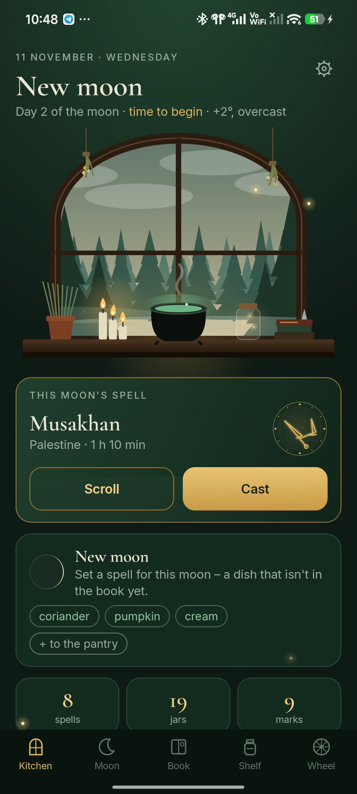
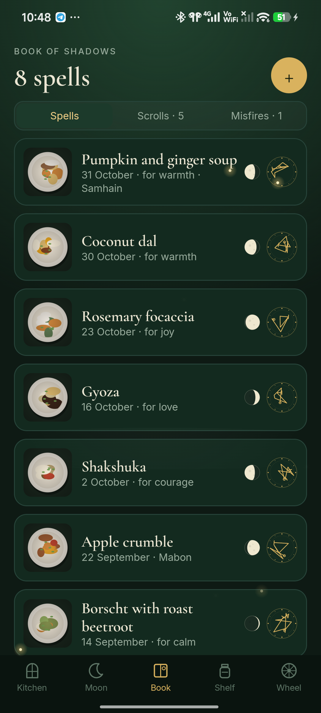
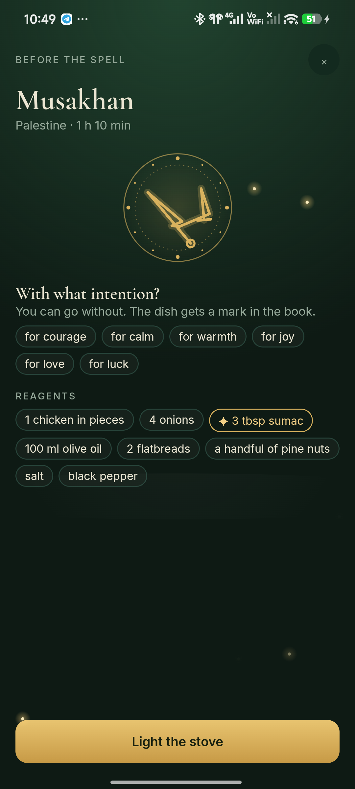

<p align="center"></p>

<h1 align="center">Kitchen Witch</h1>

<p align="center">A recipe book that gets you cooking things you've never cooked.<br>
<a href="https://bigdevwhale.github.io/stillcraft/apps/kitchenwitch/">Website</a> · <a href="https://github.com/bigdevwhale/kitchenwitch/releases/latest/download/KitchenWitch.apk">Download APK</a> · <a href="README.ru.md">Русский</a></p>

You are already a witch, and your witchcraft is cooking. There are no teachers and no homework: the moon and the year keep the rhythm. At each new moon you set one dish you've never made as the spell of that moon. Everything you cook goes into your book of shadows with a photo of the plate, a note in the margin and a sigil drawn from its reagents.

<p align="center">



</p>

## What's inside

- **The kitchen window.** A pine forest under the real moon and your town's weather: fog, fireflies at night, rain and snow. A cauldron steams on the sill.
- **The moon's rhythm.** New moon: set a new dish. Waxing: try what isn't on the shelf yet. Full moon: call guests – they sign the book. Waning: use up the leftovers.
- **The bones.** Can't decide? They pick a dish that isn't in your book yet, in season first, or only from what's waiting in the pantry. Three throws a day.
- **Cooking mode.** An intention, then the steps one at a time. A time in a step becomes a candle that burns down and rings. The screen stays on.
- **The book of shadows.** Spells, scrolls (recipes waiting to be cooked) and misfires. A misfire made good earns a mark.
- **Writing recipes down.** From the library, from a link (most recipe sites publish schema.org markup), from a photo of a page that stays in the scroll, in your own words, or from memory after cooking. You can also share a page from the browser.
- **The shelf.** 42 jars with old kitchen beliefs. A spice that first appears in a spell puts a new jar on it.
- **The wheel of the year.** Yule, Imbolc, Ostara, Beltane, Litha, Lammas, Mabon and Samhain, each with its menu.
- **Witch's marks.** 22 of them, hidden until they appear: a cauldron in a storm, bread at the full moon, a dish after midnight…
- **A library of 59 recipes** in English and Russian, from bliny to pho.

## Install

Download [KitchenWitch.apk](https://github.com/bigdevwhale/kitchenwitch/releases/latest/download/KitchenWitch.apk) on an Android 9+ phone, open it and allow installs from that source when Android asks.

## Privacy

No ads, no account, no analytics. Only the town's coordinates go out, for the weather, and the recipe pages you open by link. See [PRIVACY.md](PRIVACY.md).

## Build

JDK 17+ (Android Studio's bundled JBR works) and the Android SDK.

```
git clone https://github.com/bigdevwhale/kitchenwitch.git
cd kitchenwitch
./gradlew assembleDebug
./gradlew assembleDebug -Pdemo        # app.kitchenwitch.demo: half a year of cooking
```

Kotlin, Jetpack Compose, Room, DataStore. The window, sigils, jars and moon are drawn in code. The recipe library is `app/src/main/assets/library.tsv`.

## License

MIT. Fonts: Cormorant Garamond, Inter and Caveat (SIL OFL). Weather by [Open-Meteo](https://open-meteo.com) and [MET Norway](https://api.met.no).

Kitchen Witch is one of the [StillCraft](https://bigdevwhale.github.io/stillcraft/) apps.
