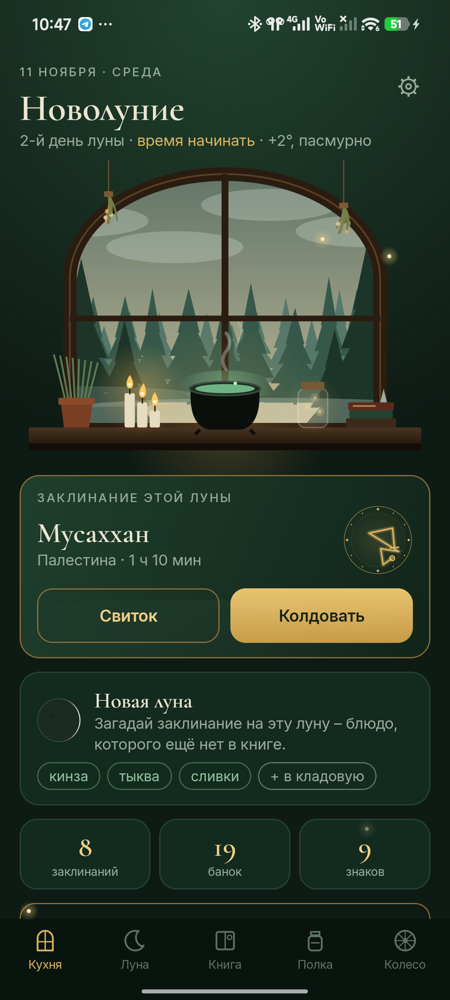
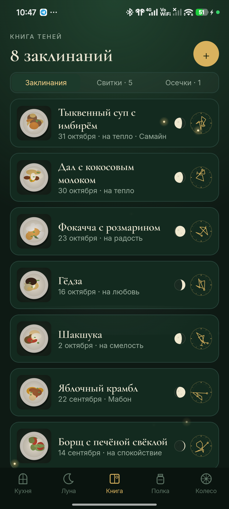
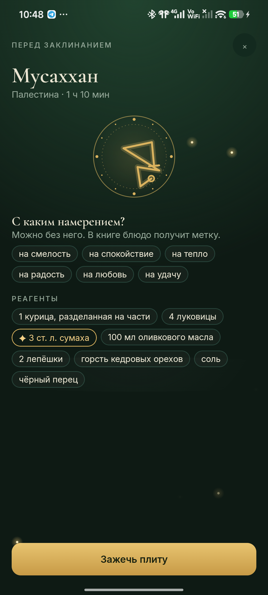

<p align="center"></p>

<h1 align="center">Кухонная ведьма</h1>

<p align="center">Книга рецептов, с которой хочется готовить то, что ещё ни разу не готовили.<br>
<a href="https://bigdevwhale.github.io/stillcraft/apps/kitchenwitch/">Сайт</a> · <a href="https://github.com/bigdevwhale/kitchenwitch/releases/latest/download/KitchenWitch.apk">Скачать APK</a> · <a href="README.md">English</a></p>

Вы уже ведьма, и ваше колдовство – это готовка. Учителей и заданий здесь нет, ритм задают луна и времена года. В каждое новолуние вы загадываете одно блюдо, которого никогда не готовили. Всё, что получилось, попадает в книгу теней: фото тарелки, пометка на полях и сигил, нарисованный из ингредиентов.

<p align="center">



</p>

## Что внутри

- **Окно кухни.** За ним сосновый лес, настоящая луна и погода вашего города: туман, светлячки по ночам, дождь и снег. На подоконнике дымится котёл.
- **Ритм луны.** В новолуние загадайте новое блюдо. На растущей луне попробуйте то, чего ещё нет на полке. В полнолуние позовите гостей – они распишутся в книге. На убывающей доешьте остатки.
- **Кости.** Не знаете, что приготовить? Кости выберут блюдо, которого ещё нет в книге: сначала из сезонных или только из того, что лежит в кладовой. Бросать можно три раза в день.
- **Готовка.** Сначала намерение, потом шаги по одному. Если в шаге указано время, появляется свеча-таймер, а когда время выходит, звенит колокольчик. Экран не гаснет.
- **Книга теней.** Заклинания, свитки – рецепты, которые ещё ждут, – и осечки. Если потом получится, за осечку дадут знак.
- **Запись рецептов.** Из библиотеки, по ссылке (большинство сайтов с рецептами это поддерживают), снимком страницы, своими словами или по памяти, когда блюдо уже готово. Страницу можно отправить в приложение прямо из браузера.
- **Полка.** 42 банки со старыми кухонными поверьями. Специя, которая впервые попала в заклинание, ставит на полку новую банку.
- **Колесо года.** Йоль, Имболк, Остара, Белтайн, Лита, Ламмас, Мабон и Самайн, у каждого праздника своё меню.
- **Ведьмины знаки.** Их 22, и заранее их не видно: котёл в грозу, хлеб в полнолуние, ужин после полуночи…
- **Библиотека из 59 рецептов** на русском и английском, от блинов до фо бо.

## Установка

Скачайте [KitchenWitch.apk](https://github.com/bigdevwhale/kitchenwitch/releases/latest/download/KitchenWitch.apk) на телефон с Android 9 или новее, откройте файл и разрешите установку из этого источника, когда Android спросит.

## Приватность

Без рекламы, аккаунта и аналитики. В сеть уходят только координаты города, чтобы узнать погоду, и страницы рецептов, которые вы открываете по ссылке. Подробнее – в [PRIVACY.md](PRIVACY.md).

## Сборка

JDK 17+ (подойдёт JBR из Android Studio) и Android SDK.

```
git clone https://github.com/bigdevwhale/kitchenwitch.git
cd kitchenwitch
./gradlew assembleDebug
./gradlew assembleDebug -Pdemo        # app.kitchenwitch.demo: полгода готовки
```

Kotlin, Jetpack Compose, Room, DataStore. Окно, сигилы, банки и луна нарисованы в коде. Библиотека рецептов лежит в `app/src/main/assets/library.tsv`.

## Лицензия

MIT. Шрифты Cormorant Garamond, Inter и Caveat (SIL OFL). Погода – [Open-Meteo](https://open-meteo.com) и [MET Norway](https://api.met.no).

Кухонная ведьма – одно из приложений [StillCraft](https://bigdevwhale.github.io/stillcraft/).
